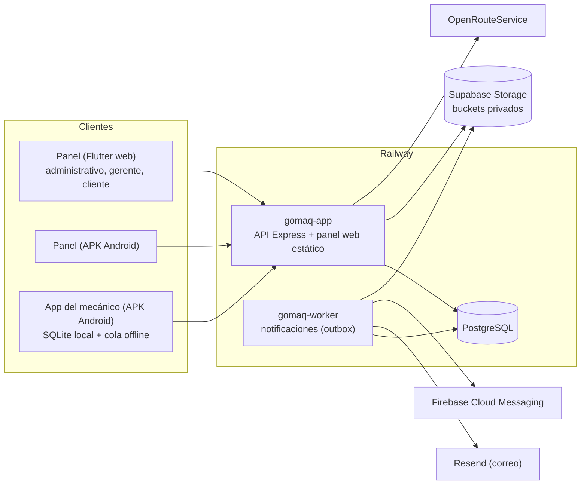

# Arquitectura y reglas de negocio

Describe cómo está construido GOMAQ y las reglas de negocio que el código hace cumplir. Para ejecutarlo,
ver el [README](../README.md); para desplegarlo, [DESPLIEGUE.md](DESPLIEGUE.md). Cada regla indica el
archivo donde vive; si el código y este documento difieren, manda el código.

## 1. Vista general



- **Backend** (`backend/`): API REST en Node.js 22 y Express sobre PostgreSQL. Sirve además el build web
  del panel (`backend/public/`, generado en la imagen Docker), por lo que API y panel comparten origen y no
  hace falta CORS.
- **Panel** (`panel/`): Flutter, web y Android. Un mismo código con vistas por rol: administrativo y gerente
  (gestión) y cliente (portal de seguimiento).
- **App del mecánico** (`terreno/`): Flutter, solo Android, offline-first.
- **Código compartido** (`comun/`): paquete Dart con el cliente HTTP (`ClienteApi`), el formato de fechas y
  montos (es_CL) y las cuentas de demostración.
- **Worker** (`backend/scripts/worker.js`): envía los avisos pendientes. Mismo código que la API, proceso aparte.
- **Base de datos** (`db/`): `schema.sql` más migraciones numeradas que aplica `backend/scripts/migrar.js`.

Decisiones de estructura del front-end (workspace de Dart, por qué `terreno/` va aparte):
[docs/tecnica/PLAN_ARQUITECTURA_FRONTEND.md](tecnica/PLAN_ARQUITECTURA_FRONTEND.md).

## 2. Backend

- `server.js`: valida las variables obligatorias al arrancar (`DATABASE_URL`, `JWT_SECRET`, `SUPABASE_URL`,
  `SUPABASE_SERVICE_KEY`), configura `helmet` con CSP explícita, CORS acotado, límites de intentos, monta las
  rutas bajo `/api/*`, sirve `public/` y el fallback de la SPA, y expone `/api/health`. Fija la zona horaria
  `America/Santiago` (los cortes de día del arriendo dependen de ella).
- `src/routes/`: un archivo por recurso (auth, maquinarias, guías, órdenes de trabajo, evidencias, facturas,
  facturación, insumos, vehículos, horómetro, checklist, rentabilidad, clientes, ejecutivos, solicitudes,
  registro de clientes, usuarios, notificaciones, dispositivos, mapa, geocodificar, dashboard).
- `src/utils/`: reglas puras y testeables sin base de datos (estados de la OT, mantención, facturable,
  rentabilidad, stock, parseo de PDF, cobranza, ETA, retención, etc.).
- `src/services/`: integraciones externas (Resend, FCM por HTTP v1 sin `firebase-admin`, OpenRouteService,
  geocodificador, sesiones, códigos de cuenta).
- `src/middleware/`: `auth.js` (`verifyToken`, `requireRole(...roles)`), `limites.js`, `upload.js` (tamaño
  y tipo de las subidas), `errores.js`.
- `src/workers/notificaciones.js`: worker de notificaciones.

### Autenticación y sesiones

- Login por correo y contraseña (bcrypt). Sin registro público para personal interno: se crea desde el
  panel o con `scripts/create-user.js`. Los clientes se registran ellos mismos y un administrativo o gerente
  aprueba la solicitud (`/api/usuarios/solicitudes`).
- La sesión es un token opaco cuyo hash se guarda en la tabla `sesiones` (migración 036): caduca a los 14
  días sin uso o a los 30 días absolutos, y se permiten hasta 20 sesiones activas por cuenta
  (`src/utils/sesiones.js`). Se puede revocar. Con `SESIONES_EN_BASE=0` el login vuelve al JWT de 12 horas.
- El secreto `JWT_SECRET` se valida al arrancar en producción (`src/utils/secretoJwt.js`).
- Un 401 hace que las apps pidan volver a entrar; el trabajo offline queda guardado en la cola.

### Roles y permisos

La autorización se declara por ruta con `requireRole(...)`; esa es la fuente de verdad. Resumen:

| Rol | Alcance |
|---|---|
| `gerente` | Lectura general; aprueba valorizaciones de reparaciones facturables; recibe avisos de gerencia |
| `administrativo` | Gestión de flota, guías, facturación, asignación de mecánicos, clientes, solicitudes, usuarios |
| `mecanico` | Solo sus órdenes asignadas (y las disponibles para tomar): diagnosticar, subir evidencia, finalizar |
| `cliente` | Solo la flota y las órdenes de su empresa (`usuarios.cliente_id`): pedir asistencia, ver seguimiento e historial |

Cada sesión registra desde qué app se abrió (`panel`, `terreno` u `otro`, `src/utils/sesiones.js`).

### Acceso a datos

- La migración 041 crea el rol de base `gomaq_app`, sin DDL y sin `UPDATE` ni `DELETE` sobre
  `ordenes_eventos`. La API y el worker pueden correr con él (`DATABASE_URL`), y los scripts de operación con el
  dueño del esquema (`DATABASE_URL_MIGRACION`).
- `ordenes_eventos` es de solo inserción (migración 020): es el historial de cada OT.
- Límites de espera de la base configurables (`DB_*_MS`, ver [DESPLIEGUE.md](DESPLIEGUE.md)).

### Archivos

Los archivos pesados van a Supabase Storage, en buckets privados con URLs firmadas temporales (1 h), nunca
públicas:

- `evidencias-ot`: fotos de evidencia que sube el mecánico.
- `documentos-gomaq`: PDF de guías y facturas que sube el administrativo.
- `equipos-gomaq`: fotos de las fichas técnicas de los equipos.

Los nombres de bucket se pueden cambiar por variable de entorno.

## 3. Orden de trabajo (OT)

### Estados y flujo

`pendiente` → `asignada` → `aceptada` → `en_camino` → `en_terreno` ↔ `en_reparacion` → `finalizada`
(`src/utils/estadosOt.js`, migración 018).

- El mecánico acepta, sale hacia el destino y al llegar pulsa Iniciar. Cada paso guarda su hora
  (`aceptada_at`, `en_camino_at`, `llegada_at`) y la app envía la hora real del toque (`ocurrio_en`), aunque
  se sincronice después. Un reintento o un cambio atrasado responde bien sin retroceder el estado.
- Una APK anterior puede pasar de `asignada` directo a `en_terreno`.
- Ninguna ruta reabre una OT `finalizada`: no se reasigna, no se reabre con `/diagnostico` ni se cierra dos
  veces. Reasignar una OT aceptada o en camino la deja `asignada` al nuevo técnico; reasignar una en curso
  cambia el técnico sin hacerla retroceder.
- **Tiempo de trabajo automático:** Iniciar abre un tramo (`tramos_trabajo`) y Finalizar cierra el que siga
  abierto. El viaje no cuenta como trabajo. Una OT puede tener varios tramos.
- **Órdenes sin asignar:** `GET /api/ordenes-trabajo?sin_asignar=1` y `PATCH /:id/tomar`, atómico: si dos
  mecánicos la toman a la vez, uno recibe 409. En la app aparece como "Órdenes disponibles", solo con señal.
- **Nueva OT desde terreno:** `POST /api/ordenes-trabajo/en-terreno`. Si el mecánico interviene un segundo
  equipo en la misma visita, abre una OT aparte para ese equipo en vez de cargar el repuesto a la orden en
  curso. Se puede crear sin señal: nace con un id local negativo y la cola lo reemplaza por el real al
  sincronizar, remapeando sus fotos, repuestos y tramos.
- Las secciones de la orden se muestran en amarillo o verde según estén completas (tipo de servicio, sistemas
  intervenidos, tiempos, observaciones y fotos). Solo las fotos DESPUÉS bloquean el cierre.
- **Despacho sin documento** (migración 019): una guía de despacho o recepción puede registrarse sin PDF con
  `sin_documento` explícito; el equipo se asigna o se libera igual, queda quién la registró y el PDF se
  adjunta después (`POST /api/maquinarias/guias/:guiaId/archivo`). El dashboard avisa cuántas guías faltan.

### La OT en papel y su equivalente

El talonario físico se trasladó a la app del mecánico:

| Formulario en papel | Dónde vive |
|---|---|
| N° preimpreso del talonario | `ordenes_trabajo.folio_papel` (opcional; la app usa su propio correlativo) |
| Cliente / RUT / Planta | `clientes` y `maquinarias.ubicacion` |
| N° serie / Modelo / N° activo | Ficha técnica del equipo (migración 007) |
| Horómetro | `lecturas_horometro` (migración 012) |
| Tipo de servicio (6 casillas) | `ordenes_trabajo.tipo_servicio`, lo marca el mecánico |
| Checklist de 31 ítems en 5 grupos | `servicios_checklist` + `ot_servicios`. Marca dónde se intervino; no es pauta de revisión |
| Inicio / Término del trabajo | `tramos_trabajo`, varios por OT |
| Cant. / Código / Descripción / Precio | `movimientos_insumo`, con `insumo_id` nullable para el repuesto escrito a mano |
| Facturable SÍ / NO / ? por línea | `movimientos_insumo.facturable`; `ordenes_trabajo.facturable` es derivado |
| Observaciones iniciales | `ordenes_trabajo.diagnostico` |
| Observaciones finales | `ordenes_trabajo.observacion_final` |
| Firma del cliente | `firmas_recepcion` (migración 011) |
| Firma del técnico | Se identifica por el usuario autenticado que cierra la OT; no se dibuja |

**El facturable vive en la línea, no en la OT.** El campo de la orden lo recalcula el backend
(`src/utils/facturableOt.js`) dentro de la misma transacción; `facturacion.js` y `dashboard.js` lo leen sin
cambios. Regla de negocio: sin repuestos no se cobra. El "?" del papel es `pendiente`, y esas líneas se
muestran a gerencia para que las resuelva desde el panel.

Sin definir con la empresa (fuera de alcance a propósito): el campo LLAMADO, el checkbox TRABAJO REALIZADO de
la cabecera y el origen de las columnas NORMALES / EXTRAS de horas.

### Precio de un repuesto

Parte del costo del catálogo y el mecánico lo puede cambiar. Si la línea no es facturable no se pide precio,
pero se guarda el costo (el costo por equipo cuenta todas las líneas). La empresa no ha definido un precio de
venta.

## 4. Horómetro y mantención preventiva

- **La lectura entra por tres vías**, y cada una queda con su `origen`: la app del mecánico al cerrar una OT
  (`movil`), el panel (`panel`) y la detección automática del PDF de la guía de entrega, que trae impreso
  `HOROMETRO: 1156` (`guia`). La guía de retiro y la factura no lo traen.
- El mecánico y el administrativo pueden registrar la lectura de cualquier equipo en cualquier momento, con o
  sin OT. En la cola offline una lectura sin orden va con `orden_trabajo_id = 0`.
- **El intervalo es por equipo**: 350 h por defecto (`maquinarias.intervalo_mantencion_horas`). Se cuentan las
  horas desde la última mantención, no el horómetro absoluto (`src/utils/mantencion.js`).
- **Mantención próxima (50 h restantes):** se ve en Pendientes del panel y se avisa por push a quienes tienen
  encendido ese aviso. `alerta_mantencion_enviada` solo se marca cuando el aviso llega a encolarse.
- **El contador se reinicia** de dos formas: el mecánico confirma "se hizo la mantención preventiva" al cerrar
  la OT (también puede hacerlo para cualquier equipo sin orden), o el administrativo la marca desde el panel
  (sirve para corregir y para cargar mantenciones anteriores al sistema).
- **Agenda mensual** (pantalla Horómetro, pestaña "Por medir"): lista los equipos arrendados sin lectura en el
  mes en curso. Como el aviso se evalúa al registrar una lectura, un equipo del que nadie toma el horómetro no
  alerta; para ese caso está la agenda. Sin confirmar con la empresa si también deben medirse los equipos en
  taller o en patio.

## 5. Costo real por equipo

Responde si, en el tiempo que un equipo estuvo en reparación, se gastó más de lo que dejó el arriendo
(`src/utils/rentabilidad.js`).

- **Gasto** = repuestos (`cantidad × precio_unitario` de las líneas de la OT). Cuenta todas las líneas, se
  hayan cobrado o no: es el costo real, no lo facturado. Las líneas sin precio se informan aparte para que un
  total bajo no se confunda con un equipo barato.
- **Ingreso** = facturas del equipo por sus dos caminos: arriendo (`facturas.maquinaria_id`) y reparación (vía
  `orden_trabajo_id`).
- **Dos vistas:** la pantalla "Costo por equipo" lista la flota con lo que sale a pérdida primero, y el perfil
  de cada equipo muestra su propio desglose.
- Quedan fuera los traslados (`guias` no guarda el monto) y las horas de trabajo (no hay valor hora definido).

## 6. Vehículos y stock del furgón

Cada mecánico tiene un furgón asignado y no rotan, y en él lleva su propio stock. Existe además un furgón de
compras que no sale a terreno: por eso un vehículo puede no tener mecánico, y solo los asignados tienen stock.

Inventario multi-ubicación (patrón *van stock*): `ubicaciones_stock` (bodega central más un furgón por
vehículo asignado) → `stock_ubicacion` (existencia de cada insumo en cada lugar) → transferencia (bodega →
furgón) → consumo (furgón → OT).

- `insumos.stock_actual` es el total derivado de todas las ubicaciones, recalculado en la misma transacción
  que mueve stock (`src/utils/stock.js`).
- **Consumir en una OT descuenta del furgón** de quien lo registra (de la bodega si lo registra el
  administrativo). Puede dejar el furgón en negativo a propósito: si el mecánico instaló un repuesto que el
  sistema no tenía, bloquearlo solo haría perder el dato. El descuadre se ve en `GET /api/insumos/descuadres`.
- **Cargar el furgón es solo online**: se hace en el taller y se valida contra la bodega en el momento, para
  que dos mecánicos no reclamen la misma pieza. Ahí sí se rechaza sacar más de lo que hay. La transferencia
  es idempotente con `uuid_cliente`.
- En la app: Mi cuenta (datos del mecánico, vehículo, documentos fotografiados) y Mi furgón (stock cacheado
  para verlo en terreno). En el panel: Vehículos, donde se crean y asignan.
- Al cliente se le avisa quién llega a reparar su equipo y con qué vehículo; la app le dice al mecánico qué
  datos de su ficha salen hacia el cliente.

## 7. La cola offline de la app del mecánico

El mecánico trabaja sin señal y la app reintenta al volver la conexión (`terreno/lib/services/sync_service.dart`).
Reglas:

- **Un reintento no duplica.** "No hubo respuesta" no significa "no se guardó". Cada tarea lleva un UUID
  generado en el teléfono (`uuid_cliente`, migración 015); si llega de nuevo, el servidor devuelve lo que ya
  existe. Cubre repuestos, tramos, horómetro, evidencias y OT creadas en terreno. Cerrar una OT ya cerrada
  responde bien sin repetir el aviso al cliente.
- **401 pausa la cola, 403 no.** Un 401 es sesión vencida: se pide volver a entrar y el trabajo queda
  guardado. Un 403 es "esta OT ya no es tuya": solo esa tarea pasa a error, con su motivo. Las OT que el
  servidor ya no entrega se quitan del teléfono si no tienen cambios pendientes.
- **El trabajo guardado es de quien lo hizo.** Si otro mecánico inicia sesión con cambios pendientes del
  anterior, la app no lo deja entrar hasta que el primero sincronice.
- **Una línea de repuesto se anula, no se borra**, como una línea tachada en el talonario: el mecánico mientras
  la OT está abierta, el panel en cualquier momento. El repuesto vuelve a su ubicación y deja de contar como
  gasto.
- **Una OT cerrada no se modifica** desde la app ni se reasigna.
- **Sincronización:** rápida (cola, OT y furgón) tras cada acción, y completa (catálogos, flota e historial) al
  abrir la app y cada 6 h. La lista se refresca al volver a primer plano y cada 3 minutos. Los cambios
  pendientes que fallan guardan y muestran el motivo.
- **Flota en la app:** toda la flota con buscador; la ficha y el historial de un equipo ajeno se descargan al
  abrirlo (con señal).
- **Orden de despliegue:** si un cambio toca la cola, desplegar primero el backend y después el APK. Contra un
  backend anterior la app sigue funcionando, pero sin la protección de `uuid_cliente`.
- Antes de actualizar el APK en un teléfono hay que sincronizar hasta ver "Todo enviado": desinstalar la app
  borra la cola pendiente.

## 8. Avisos (notificaciones)

Patrón outbox: los eventos escriben en `notificaciones_pendientes` dentro de su misma transacción y el worker
las envía (`src/workers/notificaciones.js`).

- Solo se encola lo que tiene proveedor real (`TIPOS_CON_ENVIO` en `src/utils/avisos.js`): el correo de
  factura emitida, el correo de cuenta aprobada y los push. Los demás avisos, incluido WhatsApp, no se
  encolan (la migración 046 canceló los que había). Agregar un proveedor es sumar su canal y tipo a ese
  portón y su plantilla al worker.
- El worker toma filas con `FOR UPDATE SKIP LOCKED`, de modo que un aviso no sale dos veces aunque corran dos
  procesos. Reintenta con espera creciente. Un límite del proveedor (429) se reprograma con su `Retry-After`
  sin gastar intentos (`src/utils/reintentosNotificacion.js`).
- Corre como servicio aparte para que un despliegue de la API no corte envíos a medias y para que un proveedor
  lento no comparta proceso con las peticiones de los usuarios. Operación en [DESPLIEGUE.md](DESPLIEGUE.md).
- El atajo "Avisos con problemas" del dashboard cuenta los avisos con error y los pendientes vencidos hace más
  de 10 minutos (señal de worker caído).

### Avisos push (FCM)

- El canal `push` lleva una fila por dispositivo (`dispositivos_push`, migración 048). Las apps registran su
  token con `POST /api/dispositivos` y lo dan de baja con `DELETE /api/dispositivos`; el logout desactiva los
  de la sesión.
- Tipos y destinatarios (`DESTINOS_PUSH` en `src/utils/push.js`). El worker revalida el destino antes de
  enviar: un teléfono de terreno nunca recibe avisos de gerencia ni del cliente, ni el panel los del mecánico.
  - Mecánico (app terreno): `ot_asignada`, `ot_reasignada`, `ot_disponible`.
  - Gerente (app panel): `factura_anulada`, `ajuste_inventario`.
  - Gerente y administrativo (app panel): `ot_por_valorizar`, `asistencia_nueva`, `mantencion_proxima`.
  - Cliente (app panel): `mecanico_asignado`, `ot_finalizada`, solo a usuarios de la empresa de la orden.
- El mensaje sale de una lista blanca (`src/utils/push.js`): título, "OT #id, equipo código" y el id de la
  orden. No viajan nombre, RUT ni vehículo del mecánico, observaciones, coordenadas ni el texto de la
  asistencia.
- Variables: `FCM_CUENTA_SERVICIO` (solo en el worker; sin ella el aviso espera 1 h sin gastar intentos) y
  `PUSH_HABILITADO=1` (en la API; sin él no se encola nada). Orden de activación y vuelta atrás en
  [DESPLIEGUE.md](DESPLIEGUE.md).
- La pantalla Notificaciones muestra, para un push, el nombre y rol del destinatario (no el id ni el token del
  dispositivo) y filtra por canal (`GET /api/notificaciones?canal=push|email|whatsapp`).
- **Panel:** la configuración de Firebase llega con `--dart-define` al compilar. Sin ella no se inicializa el
  plugin, no se llama al servidor y el botón de avisos no se dibuja. En la web los avisos se activan solo con
  el botón de campana (nunca se pide permiso al cargar la página); en Android se pregunta una vez.
  `panel/web/firebase-messaging-sw.js` muestra la notificación con la pestaña cerrada: no carga el SDK de
  Firebase ni lleva configuración (un service worker no lee los `--dart-define`), solo atiende el evento
  `push` y abre la OT al tocar. `server.js` lo sirve con `Cache-Control: no-cache` y el CSP permite
  `fcmregistrations.googleapis.com` y `firebaseinstallations.googleapis.com`. Safari en iPhone y iPad solo
  admite avisos web con el panel instalado en la pantalla de inicio (iOS 16.4 o superior).
- **Terreno:** mismas variables, sin `FIREBASE_VAPID_KEY`; el permiso se pide una vez tras iniciar sesión y, si
  se niega, la app sigue igual. Canal de Android "Avisos de órdenes", distinto de "Viaje en curso".
- Sin verificar contra Firebase real: el envío extremo a extremo, el formato del mensaje en el service worker
  y el aviso con la pestaña abierta.

### Mi perfil y mis avisos

Pantalla `/perfil` del panel para administrativo y gerente (nombre y teléfono, y un interruptor por cada
aviso push de su rol).

- `GET /api/usuarios/mi-perfil` devuelve además `avisos` (`[{tipo, titulo, descripcion, activo}]`, solo los de
  su rol). `PATCH /api/usuarios/mi-perfil` acepta `nombre` y `avisos` (`{ tipo: true|false }`) además de `rut`
  y `telefono_whatsapp`; un tipo ajeno a su rol, inventado o con valor no booleano responde 400 sin cambiar
  nada.
- Se guarda en `usuarios.avisos_silenciados TEXT[]` (migración 049; vacío = recibe todos). La mantención
  próxima sigue gobernada por `recibe_alertas_mantencion` (migración 012).
- Se aplica al encolar (`src/utils/avisos.js`) y otra vez justo antes de enviar (`motivoDescarte` cancela un
  aviso que el usuario apagó después: "El usuario silenció este aviso").
- La lista sale de `DESTINOS_PUSH` con los textos de `src/utils/avisosPerfil.js`; una prueba falla si se
  agrega un tipo de aviso sin su texto.
- La app del mecánico y el portal del cliente aún no tienen esta pantalla (la API ya sirve para ambos).

### Correo de factura

- **Fotos del trabajo:** el correo de una factura de reparación puede llevar, junto al PDF, las fotos antes y
  después de la orden (`evidencias_fotograficas`). Una factura de arriendo sale solo con el PDF. El
  administrativo elige las fotos en el cuadro de la factura (hasta 12, todas marcadas al inicio);
  `POST /api/facturacion/:id/autorizar-envio` acepta `foto_ids` (lista vacía = sin fotos). Sin `foto_ids` se
  repite la selección del último correo de esa factura.
- **Reducción y tope:** `src/utils/fotosCorreo.js` descarga las fotos de a una y las reduce con `sharp` a JPEG
  de 1600 px y calidad 80 (si no caben, un segundo intento a 1200 px y calidad 70). Tope de 10 MB en total sin
  contar el PDF; la API mide el peso real antes de aceptar el envío y responde 400 con el peso y el máximo; el
  worker repite el procedimiento al enviar.
- **Privacidad:** la re-codificación borra los metadatos EXIF, incluidas las coordenadas GPS. En el aviso
  (`notificaciones_pendientes.payload`) solo viajan los ids, y el worker lee únicamente fotos de la orden de
  esa factura.
- **Fotos que faltan:** si al enviar una foto ya no existe, el correo sale sin ella y queda anotado en
  `ultimo_error` ("Enviado sin N foto(s)..."). Que no quepan en el tope al enviar es un error permanente.
- **Plazo de envío:** un correo con fotos usa `NOTIF_TIMEOUT_FOTOS_MS` (60 s por defecto); el resto
  `NOTIF_TIMEOUT_MS`.
- **`sharp`** 0.35.5 trae binarios precompilados por plataforma; las imágenes Docker son
  `node:22-bookworm-slim` (Linux glibc, `linux-x64`).
- **Reenviar desde Notificaciones:** cada fila de correo de factura enviada, con error o cancelada tiene un
  botón Reenviar para el administrativo, salvo las canceladas por factura anulada, las que `GET
  /api/notificaciones` marca con `factura_existe = false` y los avisos con error por falta de proveedor. Se
  reenvía con las mismas fotos que llevó ese correo; el reenvío crea un envío nuevo y cancela el anterior que
  no hubiera salido (`Reemplazado`). En los push con error y para el gerente (que no puede autorizar envíos)
  sigue el botón Reintentar.
- **Cuenta aprobada:** al aprobar una solicitud de cuenta (`POST /api/usuarios/solicitudes/:id/aprobar`) se
  encola en la misma transacción un correo `cuenta_aprobada`. El enlace al panel viaja en el aviso (`url`, de
  `PANEL_URL` o del dominio público de Railway, nunca del host de la petición); sin URL el correo sale sin
  botón.
- **Diseño:** `src/utils/plantillaCorreoFactura.js` (HTML y texto plano) y `src/utils/envioFactura.js`
  (adjuntos). Tablas de una columna con estilos en línea. El logo va incrustado (`cid:logo-gomaq`), copia de
  `panel/assets/2.0x/logo_gomaq_sobre_oscuro.png` en `backend/src/assets/correo/logo_gomaq.png`: si se cambia
  el del panel, hay que copiarlo. Con `CORREO_CONTACTO` válido el correo lleva `reply_to`; las respuestas
  llegan a ese buzón, que debe leerse. El remitente lo define `CORREO_REMITENTE`.
- Sin verificar: `reply_to` y el logo incrustado contra Resend y Gmail reales (las pruebas usan un proveedor
  simulado).

## 9. Ubicación, mapa y hora estimada de llegada

- `GET /api/mapa` alimenta el mapa operativo del panel (mosaicos de OpenStreetMap).
- La posición del mecánico y la hora estimada de llegada (ETA) se calculan en `src/utils/etaViaje.js`,
  `etaLlegada.js` y `recalculoEta.js`; con `ORS_API_KEY` usan OpenRouteService y sin ella una aproximación en
  línea recta. El seguimiento del cliente muestra una barra de pasos y la hora de llegada.
- `GET /api/geocodificar` ayuda a ubicar direcciones (Pelias de HeiGIT, con la misma llave).
- Migraciones relacionadas: 029 a 031.

## 10. Facturación y cobranza

- Las facturas se suben como PDF y `src/utils/parsearDocumento.js` detecta fecha, tipo, folio, RUT, monto y
  horómetro con heurísticas, verificadas con texto real de documentos de la empresa (anonimizado) como fixture
  de las pruebas. Si el PDF es una imagen escaneada sin capa de texto no detecta nada y el usuario llena a
  mano; un facturador con otro formato requeriría ajustar las expresiones.
- Los días de arriendo se calculan por día calendario en `America/Santiago` con hora de corte
  (`src/utils/diasArriendo.js`, `periodosArriendo.js`); el monto del arriendo se ingresa a mano (no hay tarifa
  fija por equipo).
- Cobranza (migración 038), comprobante de pago obligatorio al marcar una factura pagada (migración 040) y
  exportación de facturación (`src/utils/exportarFacturacion.js`).

## 11. Retención de datos personales

La tarea diaria `iniciarRetencion` (en el worker) borra datos vencidos: notificaciones (180 días), solicitudes
rechazadas, sesiones y códigos de cuenta (30 días cada uno) (`src/utils/retencion.js`). Está apagada salvo
`RETENCION_ACTIVA=1`. Simulación y ejecución manual: `node scripts/retencion.js [--ejecutar]`.

## 12. Cuentas de demostración

El código incluye, y la base desplegada puede tener cargadas, tres cuentas de demostración deliberadas (administrativo, mecánico y
cliente de la empresa `Empresa Demo GOMAQ`), con botones de inicio rápido en el login del panel y de terreno.
Sus credenciales están en `comun/lib/usuarios_demo.dart` y `backend/scripts/usuarios-demo.js`, y por eso son
conocidas por quien lea el repositorio.

**Antes de usar el sistema con datos reales hay que borrarlas:**

```bash
railway ssh --service gomaq-worker "node scripts/usuarios-demo.js borrar"
```

El comando elimina los tres usuarios y la empresa de demostración (falla si la empresa ya tiene datos
asociados, para no borrar nada real). Después se retiran `comun/lib/usuarios_demo.dart`,
`backend/scripts/usuarios-demo.js` y los botones de inicio rápido de `login_screen.dart` del panel y de
terreno. Para volver a crearlas: `node scripts/usuarios-demo.js crear`.

Los datos de demostración del panel (clientes, equipos, facturas, órdenes marcados con `[DEMO]`) son otra
cosa: `node scripts/cargar_demo.js` los carga y `--borrar` los quita.

## 13. Limitaciones conocidas

- **Solo hay proveedores de correo (Resend) y push (FCM).** No existe WhatsApp ni otro canal.
- **Remitente de correo de pruebas:** mientras `CORREO_REMITENTE` sea el de pruebas de Resend (o un dominio
  provisorio), el correo solo llega a destinatarios permitidos. Cuando la empresa entregue su dominio hay que
  verificarlo en Resend, cargar los registros DNS y cambiar `CORREO_REMITENTE`.
- **Los APK release se firman con la clave de depuración** (`terreno/android/app/build.gradle.kts` y
  `panel/android/app/build.gradle.kts`). Aceptable para la demostración; antes de distribuir de verdad hay que
  crear un keystore propio (los `*.jks`, `*.keystore` y `key.properties` ya están en `.gitignore`).
- **URL pública:** la que entrega Railway (`*.up.railway.app`). Un dominio propio se agrega con
  `railway domain` sin cambios de código.
- **Tarifa de arriendo:** el monto se ingresa a mano.
- **Detección de datos desde PDF:** heurística (ver sección 10).
- **Mi perfil y avisos:** falta la pantalla en terreno y en el portal del cliente.
- Pendientes de definición de negocio con la empresa: sección 3 y 4.
